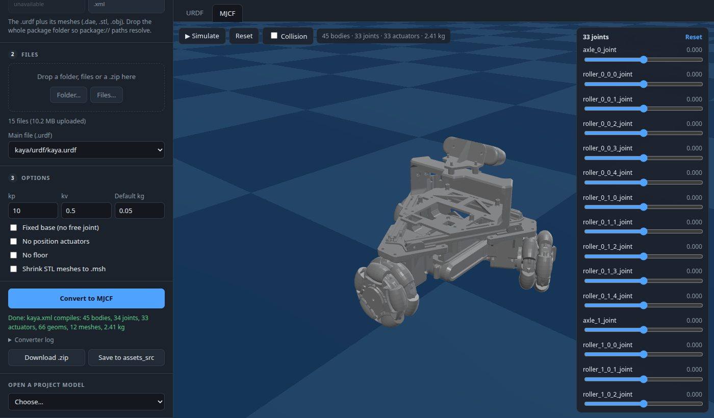

# Converter page

A local web page that turns a robot description into an MJCF model. Pick the
description type, drop in the files and convert. The source URDF and the
resulting MuJoCo model are both drawn on the page, so you can check the
result before it goes into `public/assets/`.



It runs the command-line converters described in
[model-tools.md](model-tools.md) on your machine, so it does the same
conversion and needs the same Python packages.

## Running it

```sh
npm install                                    # once: the page uses the repo's three.js and MuJoCo WASM
uv sync                                        # once: Python deps (needs uv)
uv run python tools/converter/server.py      # open http://localhost:8010/
```

Pass a port to use a different one (`server.py 8020`). The server only
listens on `localhost`. Stop it with Ctrl-C, which also deletes its work
folder (uploads and results, in a temporary folder printed at start-up).

## Converting a robot

1. **Pick the description type.**

   | Type | Upload | Needs |
   | --- | --- | --- |
   | URDF | the `.urdf` plus its meshes (`.dae`, `.stl`, `.obj`) | `mujoco`, `trimesh`, `pycollada` |
   | CoppeliaSim scene | a `.ttt` scene | the above, plus CoppeliaSim |
   | Isaac Sim USD | a `.usd` / `.usda` / `.usdc` articulation, like the Gecko | `usd-core`, `trimesh`, `scipy`, `fast_simplification` |
   | MJCF | an `.xml` model and its meshes | `mujoco` |

   A type whose Python packages are missing is greyed out, and clicking it
   says what to install. For a CoppeliaSim scene, also tell the page where
   CoppeliaSim is (see [Where CoppeliaSim is](#where-coppeliasim-is)).

2. **Add the files.** Drop a folder, several files or a `.zip` onto the
   page, or use **Folder…** / **Files…**. For a URDF, upload the whole
   package folder, so that `package://` and `../meshes/` paths resolve. If
   the selected type doesn't match the files, the page switches to one that
   does. When there are several candidates, choose the **Main file**.

   A URDF or MJCF is drawn as soon as it is uploaded. A scene or USD stage is
   drawn once it has been converted.

3. **Set the options.** They are the command-line converters' flags:

   | Option | Types | Flag |
   | --- | --- | --- |
   | CoppeliaSim folder | CoppeliaSim | `COPPELIASIM_ROOT` for the shell scripts |
   | Robot's root in the scene (model path), e.g. `/morf` | CoppeliaSim | `export_urdf.sh <scene> <model_path>` |
   | Also extract the scene's Lua scripts | CoppeliaSim | runs `extract_scripts.sh` |
   | Articulation root prim, e.g. `/Gecko` | USD | `usd_to_mjcf.py --root` |
   | Model name | CoppeliaSim, USD | output file name (default: the uploaded file's name) |
   | kp, kv | URDF, CoppeliaSim | `--kp`, `--kv` (position actuator gains) |
   | Default kg | URDF, CoppeliaSim | `--default-mass` (for links without inertial data) |
   | Fixed base | URDF, CoppeliaSim | `--fixed-base` |
   | No position actuators | URDF, CoppeliaSim | `--no-actuators` |
   | No floor | URDF, CoppeliaSim | `--no-floor` |
   | Shrink STL meshes to .msh | all | runs `stl_to_msh.py` on the result |

4. **Convert to MJCF.** The result is compiled with MuJoCo, and the status
   line gives its bodies, joints, actuators, meshes and total mass. If
   conversion fails, the **Converter log** opens with the converters'
   output. A CoppeliaSim scene takes a few seconds longer while CoppeliaSim
   starts headless.

5. **Keep the result.**
   - **Download .zip** gives `mujoco/` (the MJCF and its meshes), plus
     `urdf/` and `scripts/` for a CoppeliaSim scene.
   - **Save to assets_src** copies the same folders to
     `assets_src/<name>/`, the layout the CoppeliaSim scripts use. It asks
     before replacing folders that are already there.

   Then clean the model up and copy it to `public/assets/<name>/`, as in
   [adding-a-robot.md](adding-a-robot.md).

## Where CoppeliaSim is

The **CoppeliaSim folder** field, under Options when the type is CoppeliaSim
scene, is CoppeliaSim's install folder: the one with `coppeliaSim.sh` in it,
such as `~/CoppeliaSim_Edu_V4_10_0_rev0_Ubuntu24_04`. You can also paste the
path of `coppeliaSim.sh` itself. Press **Set** or Enter.

- The server checks the folder. The line under the field says **Found
  CoppeliaSim**, or what is wrong. **Convert to MJCF** stays disabled until
  CoppeliaSim is found.
- The folder is remembered in `~/.config/mjcf-converter.json`, so you only
  set it once per machine, even across restarts.
- Until a folder has been set on the page, the server uses
  `$COPPELIASIM_ROOT` if it is set, or else the shell scripts' default,
  `~/Research/coppelia/CoppeliaSim_Edu_V4_10_0_rev0_Ubuntu24_04`. The line
  under the field says which.
- The path is typed rather than picked with a folder dialog, because
  browsers don't tell a page where a picked folder is on disk.

## The viewers

**URDF tab.** The source robot, drawn with
[urdf-loader](https://github.com/gkjohnson/urdf-loader). There is a slider
for each movable joint (continuous joints get ±π), **Reset joints** to put
them back at zero, and **Collision** to overlay the collision shapes in
translucent orange. The info line counts links and joints, and any meshes
it couldn't find (hover over it for their names).

**MJCF tab.** The model compiled by MuJoCo in the browser, drawn with the
simulator's own [src/render/geoms.js](../src/render/geoms.js), lights,
shadows and logo sign ([src/render/view.js](../src/render/view.js)), so it
looks as it will on the robot page. The parts that use the `printed`
material are in the robot's default colour, as the robot page starts it:
`BODY_COLOR` from its robot file, else the material's own colour.

- While paused, the sliders set the joint angles directly.
- **Simulate** runs the physics. The sliders then set the targets of the
  joints' position actuators, which start out holding the current pose.
  Joints without an actuator are greyed out.
- **Reset** goes back to the model's first keyframe, or its default pose.
- **Collision** shows or hides the collision geoms when the model also has
  visual meshes: visual-only geoms, or a `VISUALS` file. The viewer loads
  that file as the site does, from the robot's `python/robots` file or a
  `<name>_visual.glb` next to the model, so the Gecko shows its full meshes
  and its hulls can be hidden. When every geom collides and there is no
  `VISUALS` file, the collision shapes are its looks and are always shown.
- **Summon demo** shows the robot as the summon page does, to set its size
  and pose there and which parts change colour (see
  [Summon demo](#summon-demo)).
- **Thumbnail** makes the picture on the robot's card in the robot menu
  (see [Card thumbnail](#card-thumbnail)).

**Open a project model** (bottom of the side panel) draws a model already in
the project: any `public/assets/*/*.xml`, `assets_src/*/urdf/*.urdf` or
`assets_src/*/mujoco/*.xml`.

## Summon demo

**Summon demo**, in the MJCF tab's toolbar, shows the robot as the summon
page does: the same pedestal, camera and lights, built by the summon page's
own code ([src/summon/stage.js](../src/summon/stage.js)). Use it to set
three things for that page: how big the robot is, how it stands, and which
parts change colour.

Show the model in the MJCF tab first: a converted result, an uploaded MJCF,
or a project model from **Open a project model**. Then press **Summon
demo**. Drag on the stage to turn the pedestal; untick **Turn by itself** to
stop it turning on its own. **Done** goes back to the viewer.

### Size on the pedestal

The summon page scales every robot so that its longest side is 1 m (the
pedestal is 1.3 m across). A tall, thin robot such as NAO then looks much
bigger than a long, flat hexapod, and its head can leave the picture.

- **Size** sets the robot's longest side on the pedestal (0.3 to 2 m).
- **Compare with** draws another project robot see-through on the same
  pedestal, at its own summon size, so the two can be matched.
- The size is saved as `SUMMON_SIZE` in the robot's `python/robots/<name>.py`,
  the file whose `MODEL` is this model. A model that no robot file uses yet
  (such as a fresh conversion) can be tried at other sizes, but its size
  can't be saved until it has one.

How much of the stage the robot fills also depends on the window's shape,
as on the summon page. Its size relative to the pedestal and to other robots
doesn't.

### Pose on the pedestal

The summon page shows the robot in its start pose: the model's first
keyframe, else its default pose. **Pose on the pedestal** has a slider for
each joint (open **Joints**), to pose it differently there only: raise an
arm, tuck the legs. **Back to the start pose** undoes it all.

The pose is saved as `SUMMON_POSE` in the robot file, holding only the
joints that differ from the start pose, for example
`SUMMON_POSE = {"RShoulderPitch": -1.4}`. The model is not changed, so the
robot page and `run_local.py`, which start from the first keyframe, are not
affected. The robot drawn by **Compare with** stands in its own summon pose.

### Parts that change colour

The summon page's colour variants, and the simulator page's **Body** colour
picker, repaint the parts that use the material named `printed`. Choose
those parts by clicking them, rather than by editing the XML.

- The parts that already use `printed` start out chosen.
- Click parts to add or remove them. With **A click picks every part of that
  colour** ticked, a click takes all parts of the clicked part's colour (on
  NAO, one click on the head takes all its orange parts). Untick it to pick
  single parts.
- **Darken the other parts** makes it easy to see which are chosen.
- **Its own colour** is the colour the chosen parts have, the Body picker's
  **Original** swatch.
- **Colour variant** previews a summon variant on the chosen parts, with
  its tier's colour on the pedestal ring.
- The chosen parts are listed by body and geom (or mesh) name; click one to
  take it off. **Choose none** clears the choice, and **As saved** goes back
  to what is in the files, size included.

Only visual meshes can be picked when the model has them, since collision
shapes are hidden on the site. A robot whose looks come from a `VISUALS`
file (the Gecko's `gecko_visual.glb`) has its colour-changing parts set
where that file is made, `tools/usd_to_mjcf.py`; its size can still be set
here. `BODY_COLOR` in the robot's `.py` file, if set, overrides the saved
colour as the Original swatch.

### Saving

**Save changes** writes what changed: the size and pose to the robot file,
and the parts to the model. For files in the project it asks first, naming
them.

What saving the parts does to the model file:

- The chosen geoms get `material="printed"`, and their own `rgba` is removed,
  since in MuJoCo a geom's `rgba` wins over its material. Where a `<default>`
  class gives them an `rgba` (as B1's `visual` class does), they get
  `rgba="0.5 0.5 0.5 1"`, MuJoCo's default, which lets the material through.
- Parts that are no longer chosen lose `material="printed"` and keep the
  colour they had, as an `rgba`.
- `<material name="printed">` is added to `<asset>` if it isn't there, and
  given the colour.
- Only those tags change: comments, `<default>` classes and the rest of the
  file stay as they were. Saving the same choice again changes nothing.
  Models using `<include>`, `<replicate>` or `<attach>` can't be saved here
  (saving says so).

Saving the size and pose writes `SUMMON_SIZE = <size>` and
`SUMMON_POSE = {...}` (one line, as the web page reads it) into the robot
file, replacing those lines if they are there, or else adding them after
`MODEL`, `VISUALS` or `BODY_COLOR`. Going back to the start pose removes the
`SUMMON_POSE` line.

## Card thumbnail

Each robot's card in the robot menu has a picture: `THUMBNAIL` in its robot
file, an 800 × 500 JPEG in `public/assets/thumbs/`. **Thumbnail**, in the
MJCF tab's toolbar, makes one with the robot page's look (floor, logo sign,
lights and shadows), like the existing cards.

1. Show the robot in the MJCF tab and press **Thumbnail**. A 16:10 frame
   shows what goes in the picture; the rest is dimmed.
2. Turn and zoom the view (drag, scroll) so the robot fills the frame. Pose
   it with the joint sliders, or press **Simulate** and let it walk.
3. **Capture** takes the picture and shows it in the bar at the bottom.
   Capture again until it looks right.
4. **Save as thumbnail** writes it to the file the robot's `THUMBNAIL`
   names, or else to `public/assets/thumbs/<robot>.jpg`, and then sets
   `THUMBNAIL` in the robot file. It asks first.

A model that no robot file uses yet can only be downloaded (**Download
.jpg**), since there is no card to put it on.

## Things to know

- **Collision geoms go in group 3.** Whatever the type, when the robot has
  visual-only meshes (`contype="0" conaffinity="0"`), every geom that
  collides is put in `group="3"`, MuJoCo's usual collision-only group. The
  simulator page and MuJoCo's desktop viewer then show the visual meshes and
  not the collision shapes on top of them. The floor and other geoms on the
  world body are left alone, and so is a robot without visual meshes, whose
  collision shapes are also its looks. The log says how many geoms moved.
  An MJCF that needed it is written back out by MuJoCo, so its formatting
  changes, but not the model. This is `set_collision_group` in
  [urdf_to_mjcf.py](../tools/coppeliasim/urdf_to_mjcf.py), which applies it
  from the command line too.
- **URDF colours are dropped.** MuJoCo's URDF importer doesn't keep URDF
  material colours, so the MJCF comes out grey. Set colours in the MJCF
  during clean-up.
- **Errors in the URDF itself** show up in the log as MuJoCo's message, for
  example `XML Error: bad format in attribute 'xyz'` with the line number.
- **USD conversion** is the Gecko's converter: it expects an Isaac Sim style
  articulation with Z-axis revolute joints. Its MJCF holds collision hulls
  only; the full visual meshes go to `<name>_visual.glb`, which the page
  doesn't draw.
- **The Unitree B1 converter** (`b1_to_mjcf.py`) isn't on the page because
  it is specific to the B1. Run it from the command line.
- **No embedded scripts found** in the log means `extract_scripts.sh` found
  nothing to dump in the scene. This happens with
  `MORF_BasicLocomotionLearning.ttt`.

## How it works

| File | What it is |
| --- | --- |
| [tools/converter/server.py](../tools/converter/server.py) | Python standard-library HTTP server: uploads, running the converters, downloads |
| [tools/converter/index.html](../tools/converter/index.html) | The page's layout and styles |
| [tools/converter/app.js](../tools/converter/app.js) | Side panel: types, uploads, options, convert, save |
| [tools/converter/viewers.js](../tools/converter/viewers.js) | The URDF and MJCF viewers |
| [tools/converter/summon-demo.js](../tools/converter/summon-demo.js) | Summon demo: the summon stage, size, pose, comparison and part picking |
| [tools/converter/thumbnail.js](../tools/converter/thumbnail.js) | Card thumbnail: the frame and capture |
| [tools/converter/paint.py](../tools/converter/paint.py) | Writing the chosen parts to the MJCF file |

Each set of uploaded files is a *job*, with a folder of its own in the work
folder: `input/` for the uploads, `mujoco/` for the result, and `urdf/` and
`scripts/` for a CoppeliaSim scene. Uploading new files starts a new job.

| Request | Does |
| --- | --- |
| `GET /api/types` | The description types, and why any can't run here |
| `GET /api/library` | The project's existing models |
| `GET /api/coppeliasim` | Where CoppeliaSim is looked for: `{ path, found, source }` |
| `POST /api/coppeliasim` | Checks and remembers CoppeliaSim's folder: `{ path }` |
| `GET /api/robots` | Every `python/robots` file's `MODEL`, `VISUALS`, `THUMBNAIL`, `SUMMON_SIZE`, `SUMMON_POSE` and title |
| `GET /api/robot?url=…` | The robot file using a model, and its `VISUALS` file |
| `POST /api/summon` | Writes `SUMMON_SIZE` and `SUMMON_POSE` into the robot file using a model: `{ url, size, pose }` (null: leave as it is) |
| `POST /api/thumbnail?url=…` | Saves the JPEG in the body as the card picture of the robot using the model |
| `POST /api/paint` | Makes exactly the given geoms use `printed`: `{ url, geoms, color }` |
| `POST /api/jobs` | Starts a job |
| `PUT /api/jobs/<id>/input/<path>` | Uploads one file (a `.zip` is unpacked) |
| `POST /api/jobs/<id>/files` | Lists the job's uploaded files |
| `POST /api/jobs/<id>/convert` | Runs the converter: `{ type, main, options }` → `{ ok, log, mjcf, urdf }` |
| `GET /api/jobs/<id>/download` | The result as a `.zip` |
| `POST /api/jobs/<id>/save` | Copies the result to `assets_src/<name>/` |
| `GET /api/mesh?urdf=…&file=…` | A URDF's mesh, found the way `urdf_to_mjcf.py` finds it |

The converters run as subprocesses with the server's own Python
(`sys.executable`), which is why the server should be started with the venv's
Python. The page loads three.js and MuJoCo WASM from the repo's
`node_modules/`, and urdf-loader from jsDelivr.

To see a URDF's meshes, the page points every `<mesh filename>` at
`/api/mesh`. That uses `resolve_mesh` from `urdf_to_mjcf.py`, so the viewer
and the converter find the same file. The lookup tries the path relative to
the URDF, then the `package://` package in a folder above it, then the file
name next to the URDF (CoppeliaSim writes absolute paths from the exporting
machine). Failing those, it takes the best name match anywhere in the
upload.

For the MJCF view, the page reads the model's XML and fetches the files it
references (meshes, textures, height fields, skins and `<include>`d files,
using the `<compiler>` directories). It writes them into MuJoCo's in-memory
file system and compiles the model there.
